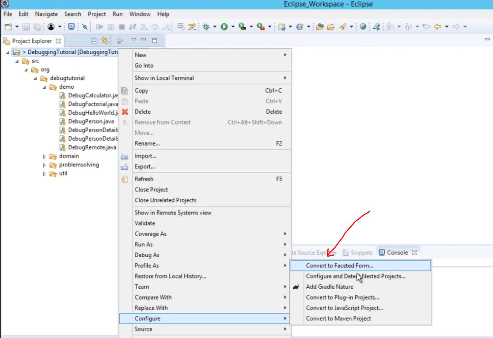
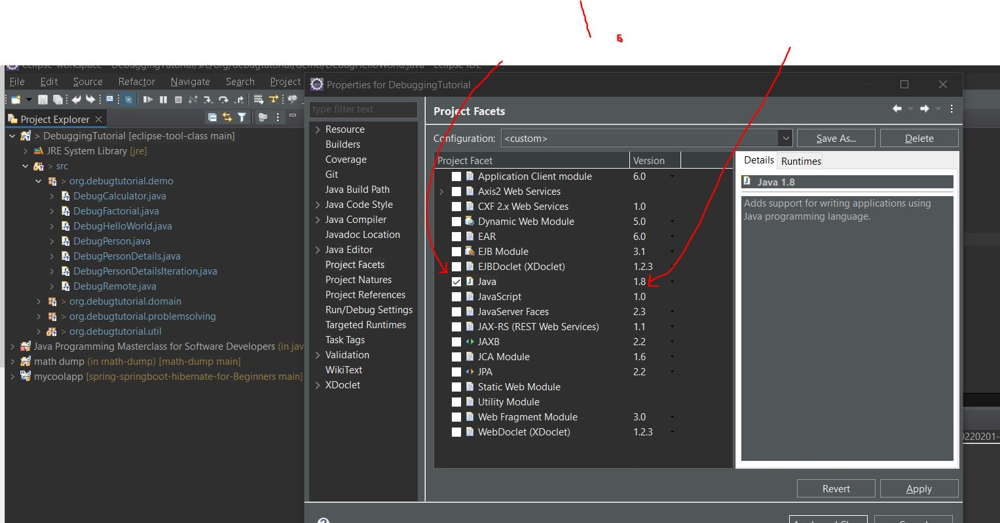

# Section 01: Introduction to Java Debugging Using Eclipse. ✅

## Introduction to Java Debugging Using Eclipse

# What I Learned. ✅

- Repository: [GitHub link](https://github.com/j2eeexpert2015/DebuggingTutorial)

- If you cannot run `.java` files:
  - Try to **Convert to Faceted Form**.

    

 

    

1. Check the Java options. We recommend selecting `1.8`.