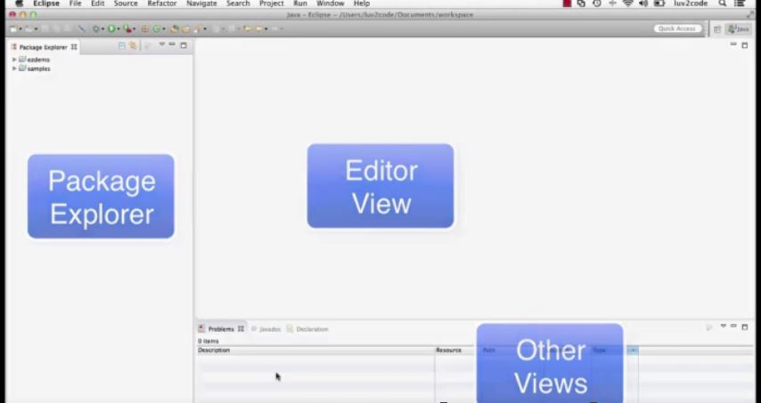
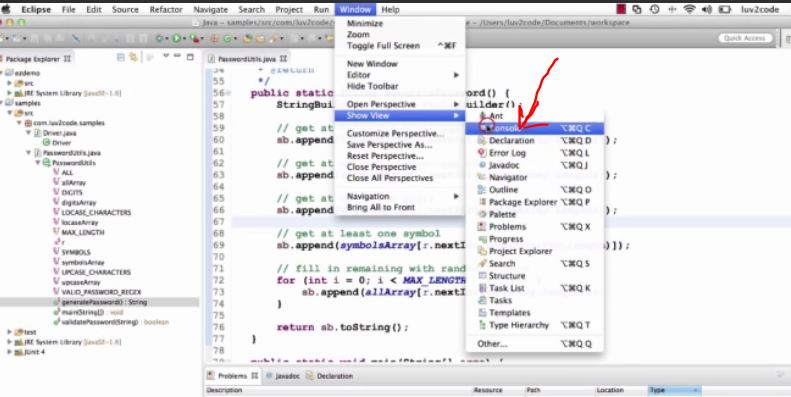
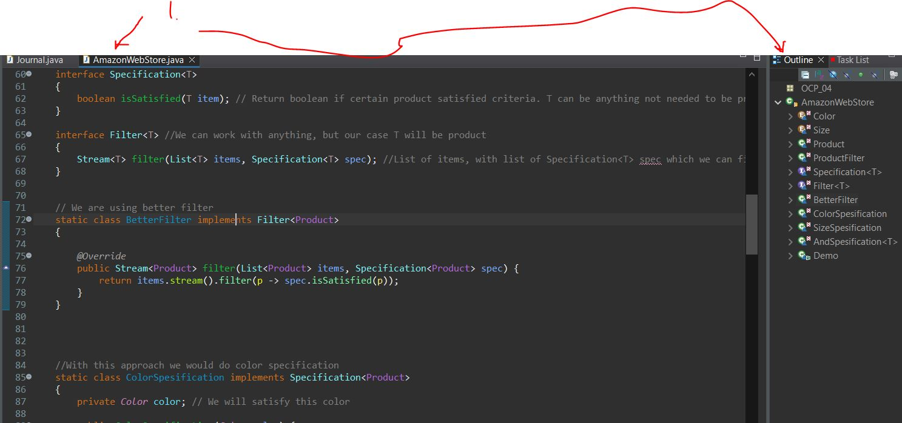
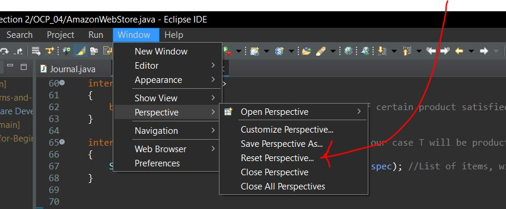

# Section 02: Getting Started with Eclipse. ✅

Getting Started with Eclipse.

# What I Learned. ✅

# Installing the Eclipse IDE. ✅

# Create a Java Application with Eclipse. ✅

# Exploring the Eclipse User Interface. ✅

- todo these ones

- Different sections in eclipse IDE

    

- If lose some window tab, these can be opened form here. Here example Console tab

    

### Outline View 

> **Window** > **Show View** > **Outline**

- **Outline View** is showing different way to show class

    

1. Here you can see Outline

- Eclipse can be easily modified window positions

- Eclipse is following concept **Perspective**
    - **Perspective** is how layout is formed in Eclipse IDE

- You can always reset perspective if mess things up

    

