# Section 03: Managing Source Code. ✅

Managing Source Code.

# What I Learned.

# Searching and Navigating Source Code (part 01). ✅

# Searching and Navigating Source Code (part 02). ✅

# Generating Java Source Code. ✅

# Refactoring Code - Extract Constants and Variables. ✅

# Refactoring Code - Extract Methods, Rename Methods and Variables. ✅

- Todo change these ones

### Open Type.

- Open class by name

    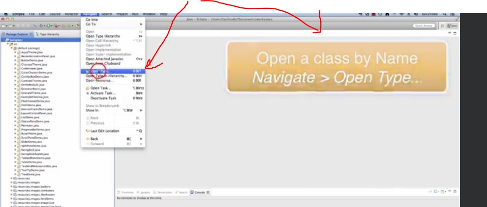

- We can open type by name from here

    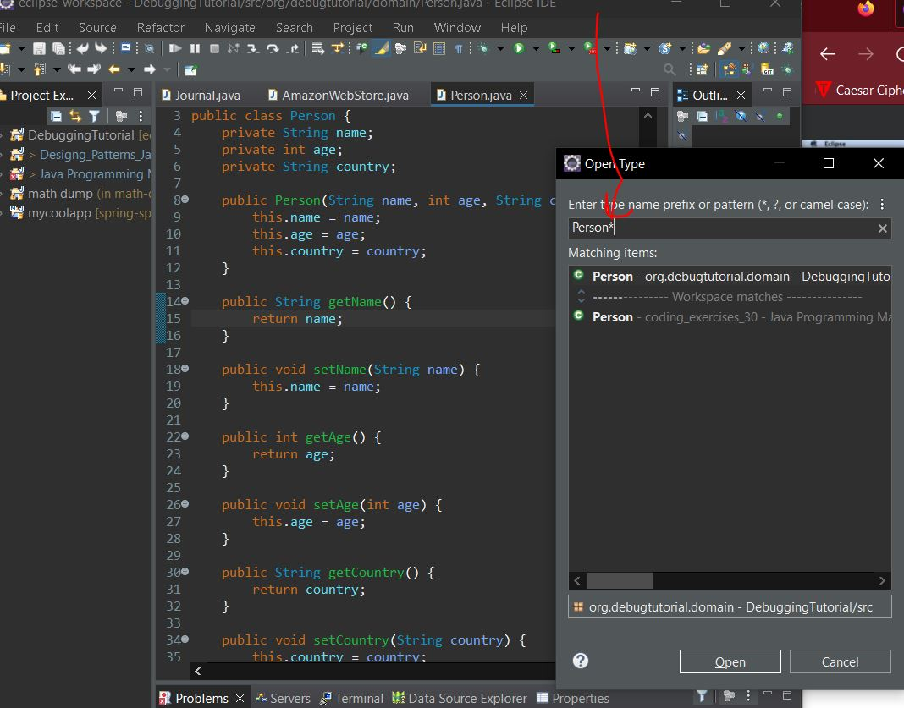

- You can use **wildcards** in Eclipse. Here is usage when opening type

    

### Quick Outline

- You can open outline view

    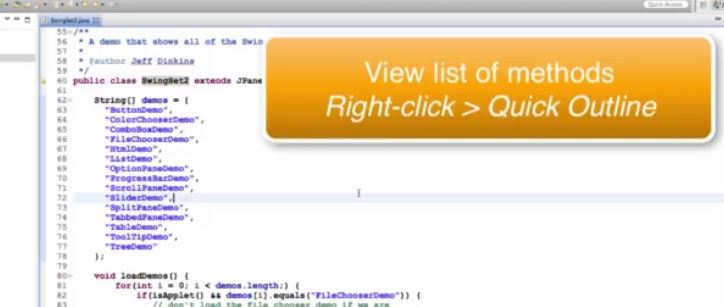

- And it will look like such

    

- You can also filter in this menu

### Display inheritance tree

> **Navigate** > **Open Type Hierarchy** 

- This will help you to look inheritance tree for class

    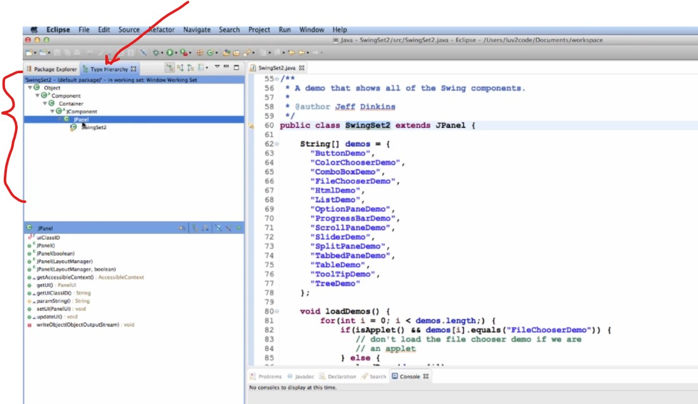

### Display Quick Inheritance Tree.

> Right-click > Quick Type Hierarchy

    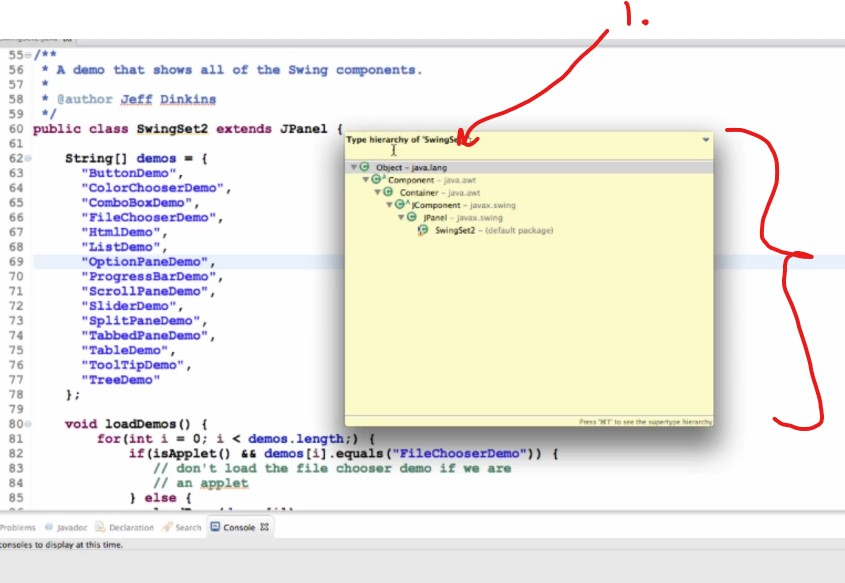

- Quick Type Hierarchy

1. You can type to filter 

### Search For Text.

> CTRL + F

- Search for text, with different tools

    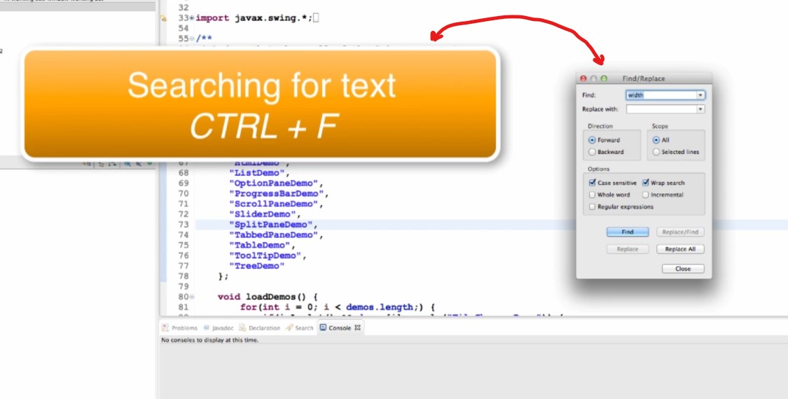

- If you have multiple files

### Search For Multiple Files.

> Search > Search 

    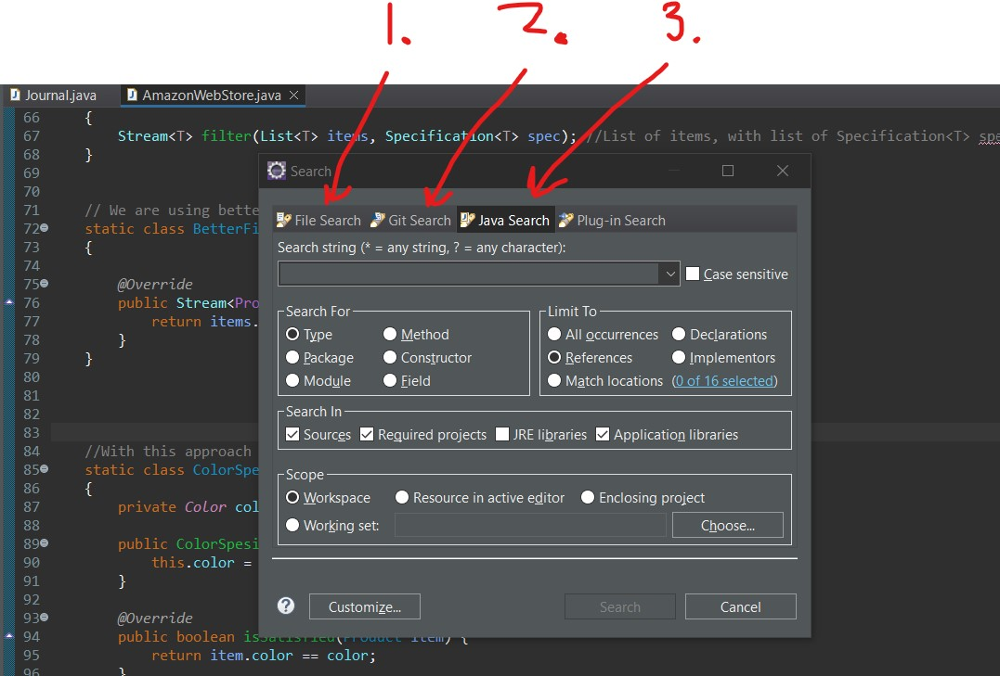

1. **File Search**, can search plain text from multiple files
2. **Git Search**, you can search against Git repository
3. **Java Search**, search against Java constructs

    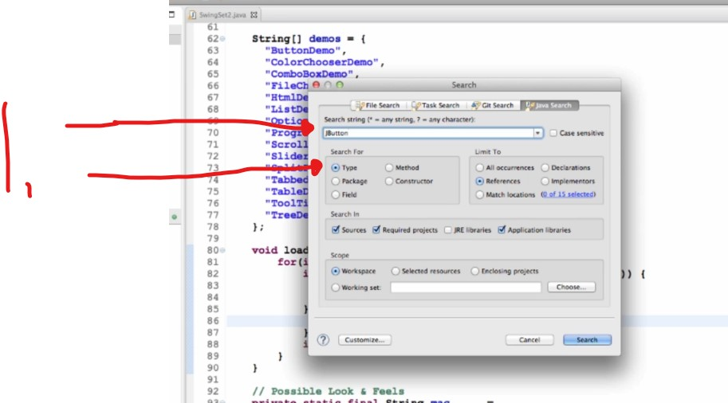

1. We are searching for where `JButton` is used in this project

    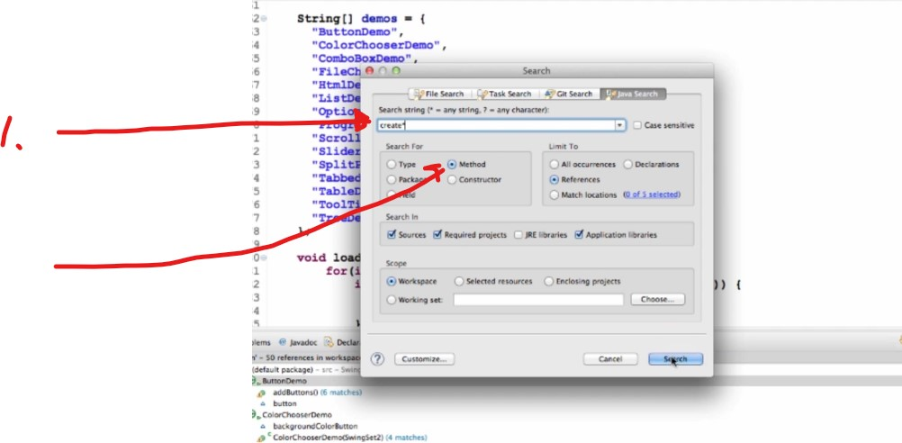

1. We are using `*` wild card with method name `create*`. Searching **method** name start with `create`

### View Method Detail

> Right-click > Open Declaration (**F3**)

- Opens declaration of method when opened 

### Finding Reference For Method

> Right-click > References > Workspace

    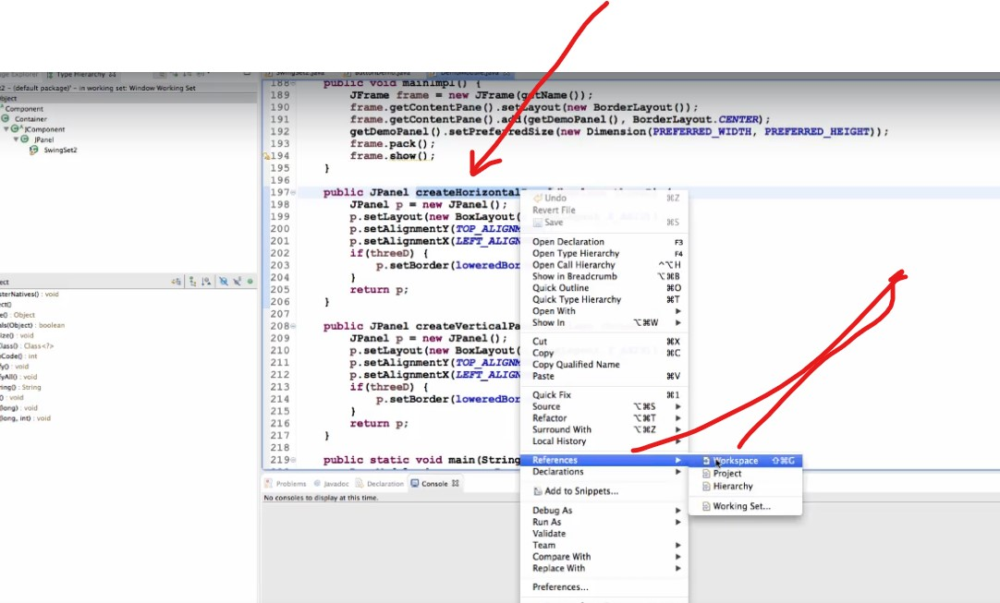

- We can look where this method is being called

### Call Hierarchy: Sequence of methods calls

> Right-click > Open Call Hierarchy

- Given sequence of methods calls.

    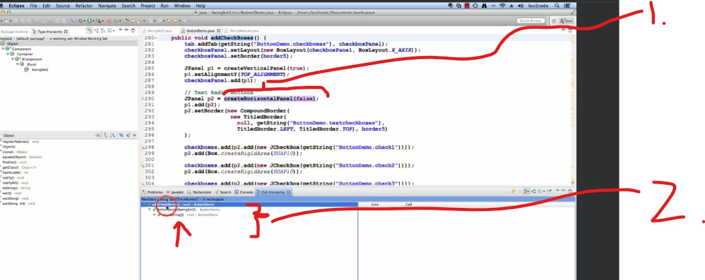

1. We are calling `Call Hierachy` here.
2. We are reading this from **top** to **bottom**. **Main method** is calling our **constructor** which in sense is calling **our method** `create*`.

### Generating Getters and Setters

> Right-click > Source > Generating Getters and Setters

    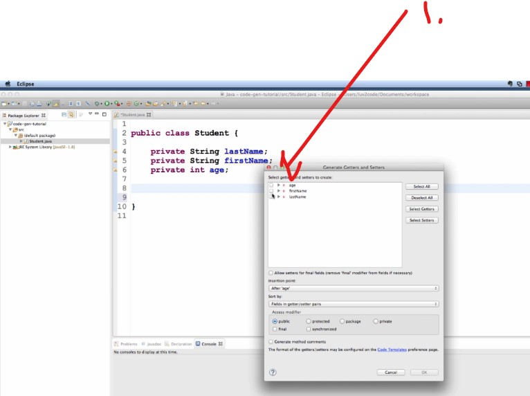

1. We can generate fetters and setters from class fields

### Generating Constructor using fields

> Right-click > Source > Generating Constructors using fields

    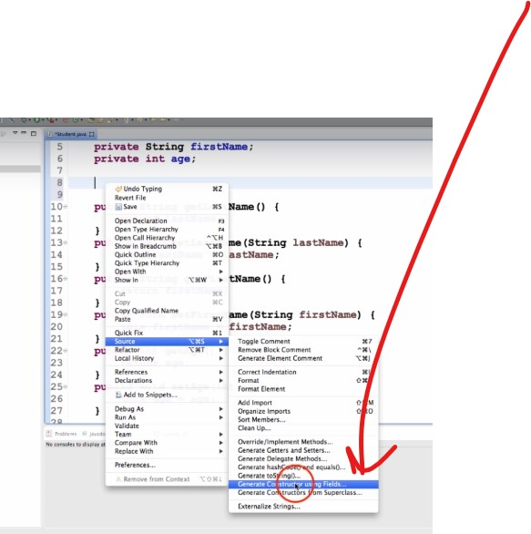

### Override / Implement Methods

> Right-click > Source > Override / Implement Methods

    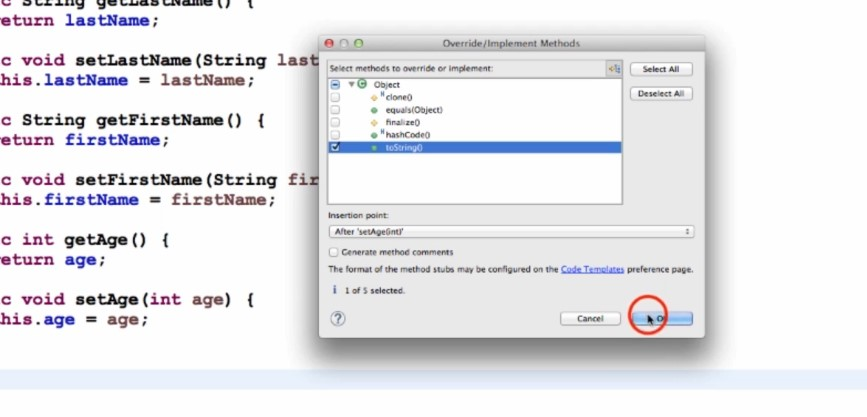

- Usually we be overriding `toString()` method

### Template shortcuts

    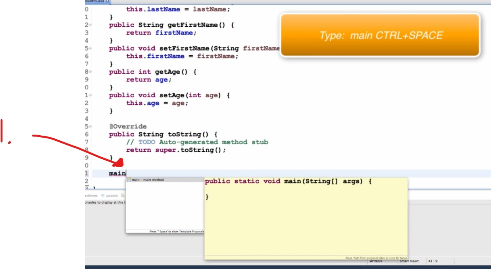

1. `Ctrl+Space` will auto complete code from template 
    - These can be found in Eclipse 
> Java > Editor > Templates > Main

    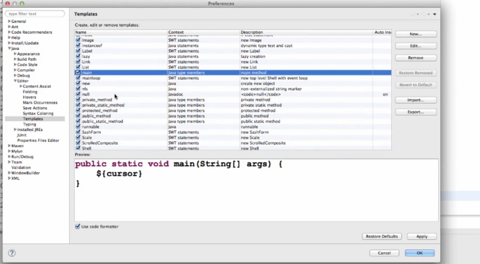

### Format.

> Right-click > Source > Format

### Refactoring.

    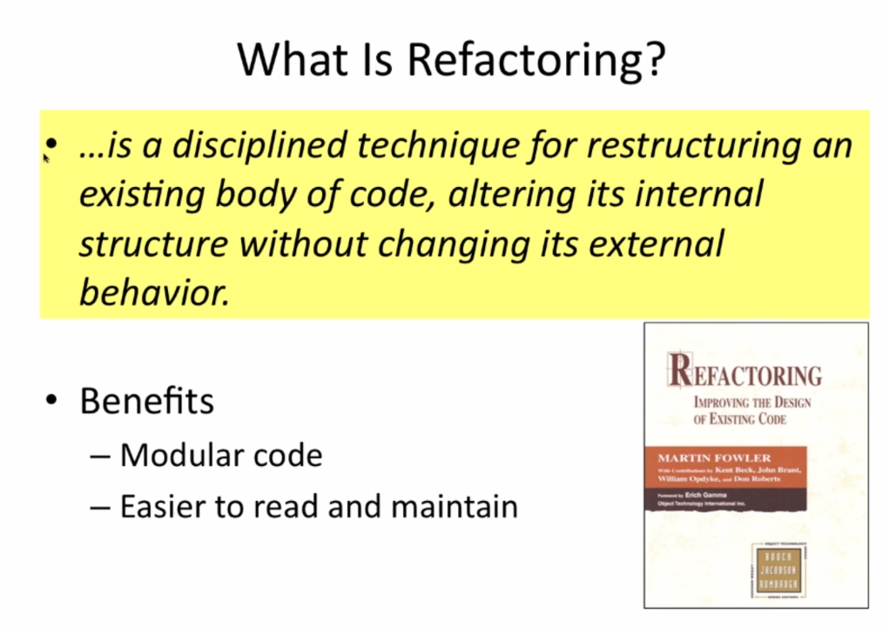

### Extract Constant.

    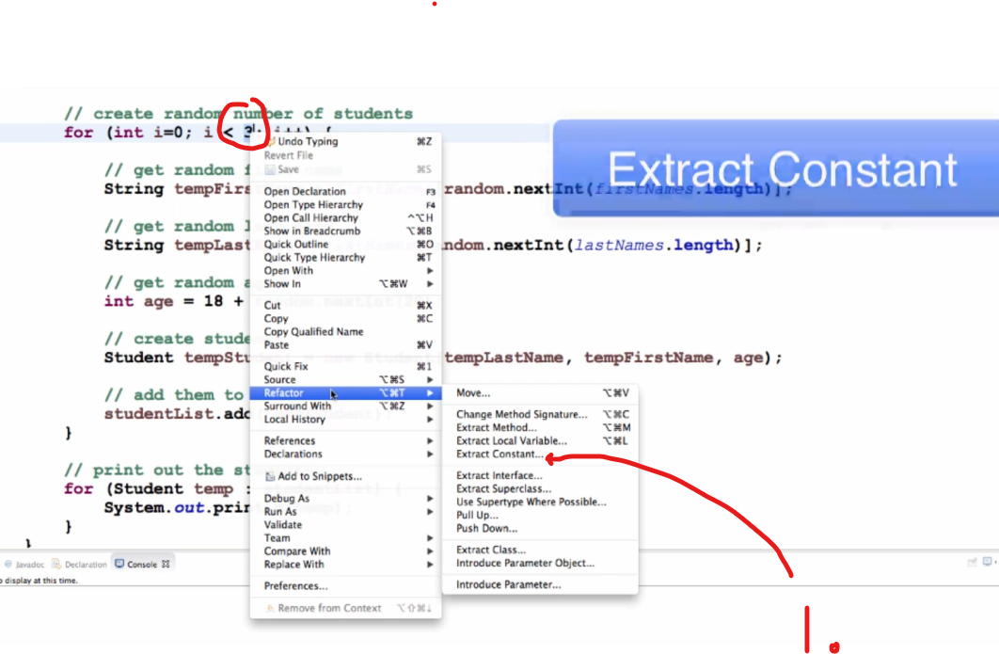

1. Write new for **Extracted Constant**

    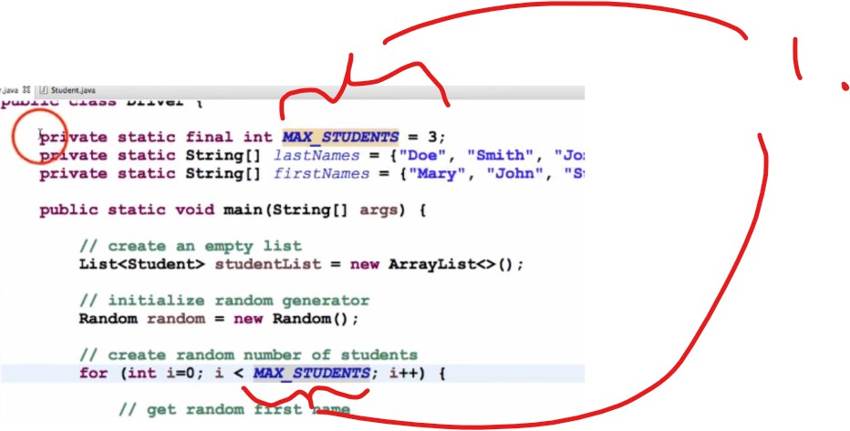

1. Extracted to own variable.

### Extract Local Variables.

> Color the code which you want to extract from code > Refactor > 

**Extract Local Variable**

### Extract Methods.

    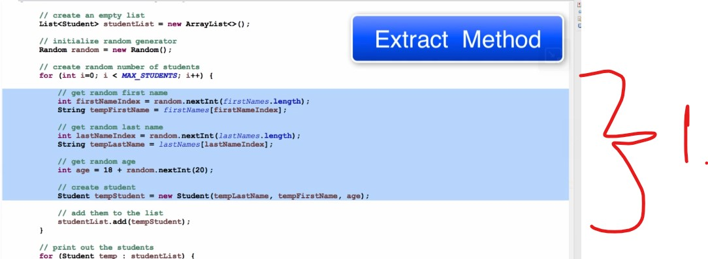

1. We can see this is one logical chunk of code, we want to extract this one

> Color the code which you want to extract to method > Refactor > **Extract Method...**

- Input name here to be refactored into 

    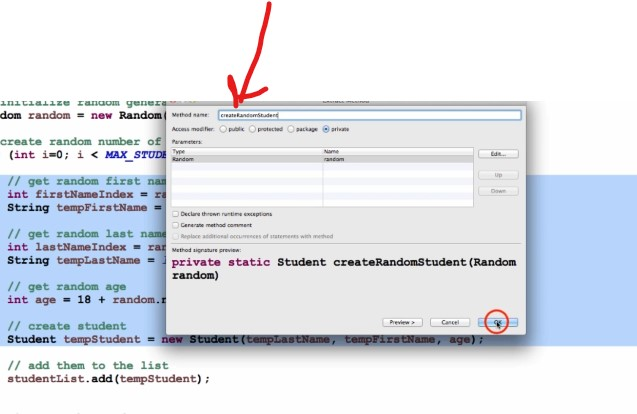

### Rename Method or variable.

- Renaming method or variables.

> Right-Click > Refactor > Rename...
