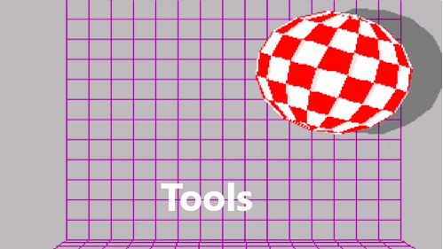

<!-- 

We are using following structure:

<p 
align="center">
    
</p> 
<p 
align="center">
    
</p>
-->

<!--
Template for the questions:

# Quiz 07: Atomic Operations, Volatile & Metrics Practical Example.

<details>
<summary 
id="Quiz_01_Question_01"
open="true"> <b>Question 01.</b> </summary>
````Yaml
Question 01:
The question comes here!

- My answer:

<div
align="center">
    
</div>

1. Add here the answer!

</details>
-->

<!-- 
Template for the task/exercies:
 
# Lab Exercise - Mapping Collections of Value Types.

<div 
align="center">
    
</div>

1. **Question 1:** add here the question from the test!
	- **Answer:** **D**. here can be the examplaniton!
 -->

# Tools repo.

<table>
  <tr>
    <td align="left">
      
    </td>
    <td align="center">
      
    </td>
    <td align="right">
      
    </td>
  </tr>
  <ww>
  <text>Attempt to study <b>Tools</b> and related topics!</text>

</table>

<text>Attempt to study <b>Tools</b> and related topics!</text>

- For these courses one should configure **GIT** for handle projects.
    - `git config --global http.postBuffer 524288000`.
    - `git config --global core.longpaths true`.

<hr>


All course material from **Eclipse Debugging Techniques And Tricks by Learning** by from Experience/Swapan Kumar Dutta 

If the content sparked :fire: your interest, please consider buying the course and start learning :book:

[Course at Udemy](https://www.udemy.com/course/eclipse-debugging-techniques-and-tricks/)   

[GitHub Course Project Link](https://github.com/j2eeexpert2015/DebuggingTutorial)

[GitHub of Maker](https://github.com/j2eeexpert2015)


<!-- 
Linkedin puts this shit front, when clicking from private mode x(. Need to put this to make jump working every case
?trk=public_profile_see-credential 
-->

<p 
id="Logo_Combination" 
align="center">
    
    
</p>

**Note: The material provided in this repository is only for helping those who may get stuck at any point of time in the course. It is very advised that no one should just copy the solutions(violation of Honor Code) presented here.**

#### Progress/Curriculum.

- [x] [Section 01](https://github.com/developersCradle/eclipse-tool-class/tree/main/Section%201%20eclipse%20debugging) - Introduction to Java Debugging Using Eclipse. ✅
- [x] [Section 02](https://github.com/developersCradle/eclipse-tool-class/tree/main/Section%202%20eclipse%20debugging) - Basic Debugging Features. ✅
- [ ] [Section 03](https://github.com/developersCradle/eclipse-tool-class/tree/main/Section%203%20eclipse%20debugging) - Advanced Debugging Features.
- [ ] [Section 04](https://github.com/developersCradle/eclipse-tool-class/tree/main/Section%204%20eclipse%20debugging) - Sample Debugging Problems And Their Solution.
- [x] [Section 05](#) - Thank You! ✅
- [x] [Section 06](#) - Bonus Section. ✅

# Eclipse IDE for Beginners: Increase Your Java Productivity.

<!-- 
<p 
align="center">
    
</p> 
-->

<p 
align="center">
    
</p> 

All course material from *Eclipse IDE for Beginners: Increase Your Java Productivity* by **Chad Darby**.

>. 🐟 <br><br> ~ DevelopersCradle

Contains my own with my own visual notes ✍️ with some course material to enforce learning experience.

This repository is made with [](#) hotkeys, therefore it will include configuration files which are related to this IDE this approach will be favored for now. ⚙️

[Course at Udemy](https://www.udemy.com/course/luv2code-eclipse-ide-for-beginners/).

[Maker Home Page](https://luv2code.com/).

If the content sparked :fire: your interest, please consider buying the course and start learning :book:

<!-- 
Linkedin puts this shit front, when clicking from private mode x(. Need to put this to make jump working every case
?trk=public_profile_see-credential 
-->

<p 
id="Logo_Combination" 
align="center">
    
    
</p>

**Note: The material provided in this repository is only for helping those who may get stuck at any point of time in the course. It is very advised that no one should just copy the solutions(violation of Honor Code) presented here.**

#### Progress/Curriculum.

- [x] [Section 01](#) - Course Introduction and Special Discount Offer. ✅
- [x] [Section 02](https://github.com/developersCradle/eclipse-tool-class/tree/main/Section%202%20eclipse%20productivity) - Getting Started with Eclipse. ✅
- [x] [Section 03](https://github.com/developersCradle/eclipse-tool-class/tree/main/Section%203%20eclipse%20productivity) - Managing Source Code. ✅
- [x] [Section 04](https://github.com/developersCradle/eclipse-tool-class/tree/main/Section%204%20eclipse%.0productivity) - Advanced Features. ✅
- [x] [Section 05](#) - Summary. ✅

#### Additional stuff.

- stuff(#)!

#### The Quizzes and Labs.

* **Section xx**:
    * *Quiz*:
        * [xx](#). 


<hr>


All course material from **Devtools Pro: The Basics of Chrome Developer Tools** by Rocco Balsamo and if you want to keep going even further, he has also paid course for even better/deeper knowledge.

If the content sparked :fire: your interest, please consider buying the course and start learning :book:

[Course at Udemy](https://www.udemy.com/course/devtools-2017-the-basics-of-chrome-developer-tools/)   

[Maker Home Page](https://simmer.io/)   

<!--  -->

Insert certificate here when completed

**Note: The material provided in this repository is only for helping those who may get stuck at any point of time in the course. It is very advised that no one should just copy the solutions(violation of Honor Code) presented here.**

#### Progress/Curriculum.

- [ ] Section 1 - The Basics
- [ ] Section 2 - Digging Deeper
- [ ] Section 3 - Bonus

<hr>

some other todo:
- todo make shortcut pdf and .md
- todo https://www.udemy.com/course/devtools-2017-the-basics-of-chrome-developer-tools/
- todo https://www.udemy.com/course/eclipse-java-tutorial-for-beginners/
- todo https://www.udemy.com/course/eclipse-tips-and-tricks/


# Eclipse hotkeys.

> Open implementation - **F3**.


- Opens where `Spesification` is **implemented** in.

> Show all usages of a variable - **Ctrl + Shift + U**.


### Debugging hotkeys.

> Step Over - **F6**.


- Line get executed and control is given in next line 
