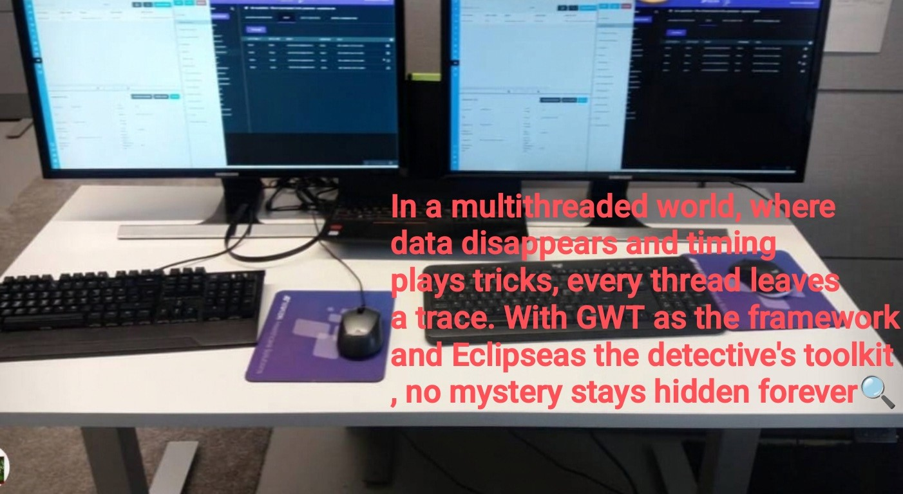
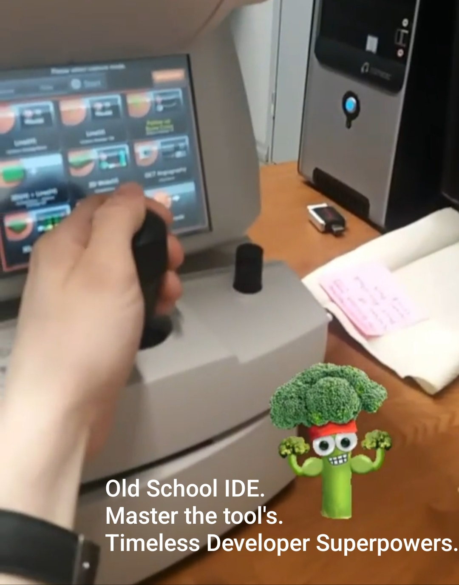
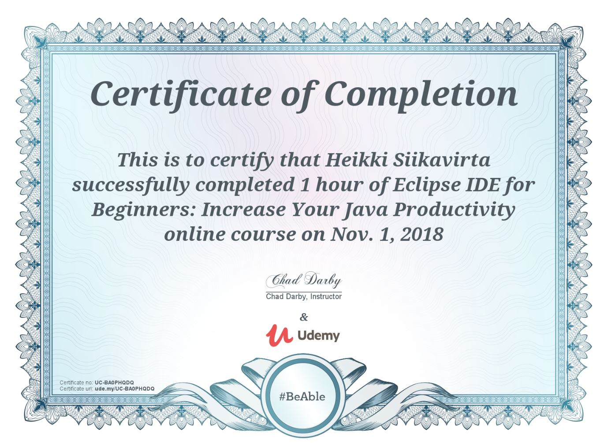
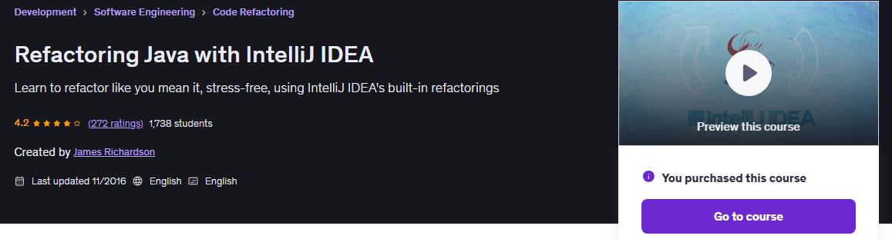
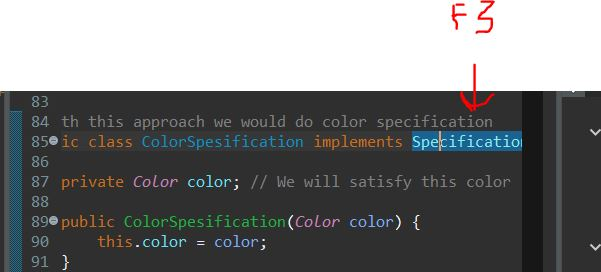
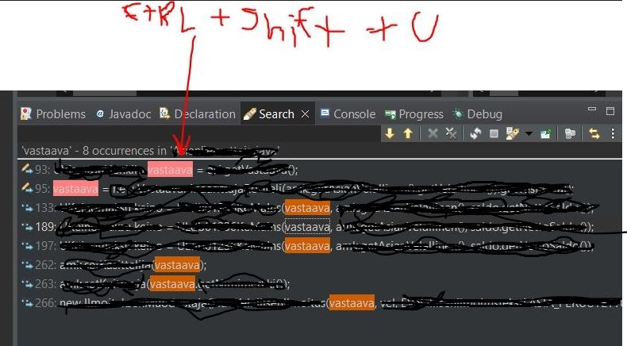
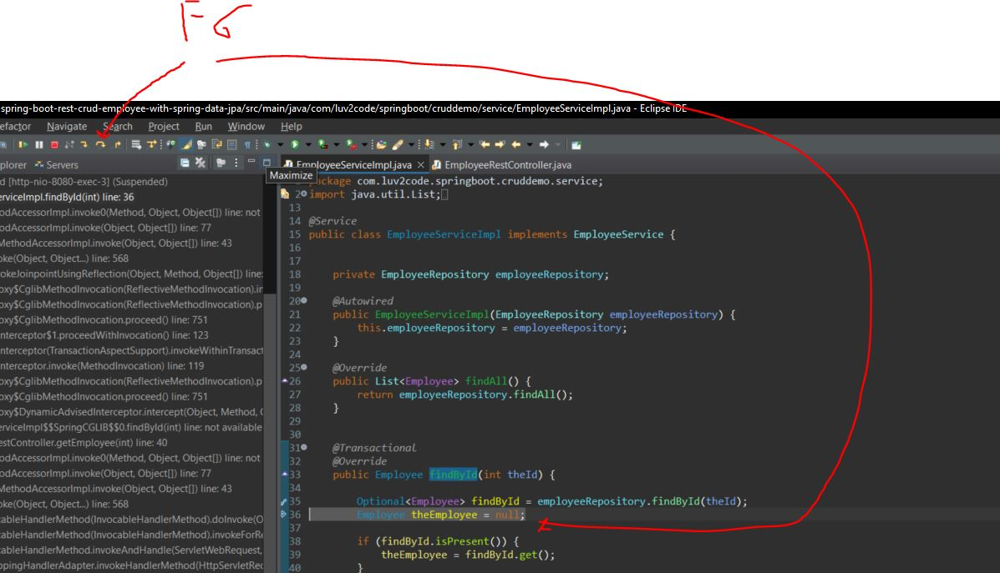

<!-- 

We are using following structure:

<p 
align="center">
    
</p> 
<p 
align="center">
    
</p>
-->

<!--
Template for the questions:

# Quiz 07: Atomic Operations, Volatile & Metrics Practical Example.

<details>
<summary 
id="Quiz_01_Question_01"
open="true"> <b>Question 01.</b> </summary>
````Yaml
Question 01:
The question comes here!

- My answer:

<div
align="center">
    
</div>

1. Add here the answer!

</details>
-->

<!-- 
Template for the task/exercies:
 
# Lab Exercise - Mapping Collections of Value Types.

<div 
align="center">
    
</div>

1. **Question 1:** add here the question from the test!
	- **Answer:** **D**. here can be the examplaniton!
 -->

<p 
align="center">
    
    <text>Usage of <b>Eclipse/IntelliJ IDEA</b> and other related tools for web development!</text>
    <table>
    <tr>
        <td align="left">
        
        </td>
        <td align="center">
        
        </td>
        <td align="right">
        
        </td>
    </tr>
    </table>
</p>

- For these courses one should configure **GIT** for handle projects.
    - `git config --global http.postBuffer 524288000`.
    - `git config --global core.longpaths true`.

<p 
align="center">
    
</p>

<p 
align="center">
    
</p>


All course material from *Eclipse Debugging Techniques And Tricks by Learning* by from **Experience**/**Swapan Kumar Dutta**. 

> While working with **GWT applications** in the ❄️**Kide Systems**❄️ I was involving in situation where there was, multiple threads, debugging could sometimes feel like chasing ghosts. 👻 Data would mysteriously disappear, and tracking down the exact moment and place where things went wrong was not always an easy task. It was one of those situations where having the right debugging tools could make all the difference. 🐟
>
> Revisiting Eclipse IDE's debugging features reminded me how valuable those tools really are. Breakpoints, stepping through execution, inspecting expressions, and following the flow of method calls can bring much-needed clarity to even the most confusing debugging scenarios. 🐟
>
> After all, debugging is not just about finding bugs. It is about making sense of the chaos behind the code. 🐟 <br><br> ~ DevelopersCradle

Contains my own with my own visual notes ✍️ with some course material to enforce learning experience.

This repository is made with [](#) hotkeys, therefore it will include configuration files which are related to this IDE this approach will be favored for now. ⚙️

[Course at Udemy](https://www.udemy.com/course/eclipse-debugging-techniques-and-tricks/).

[GitHub Course Project Link](https://github.com/j2eeexpert2015/DebuggingTutorial).

[GitHub of Maker](https://github.com/j2eeexpert2015).

If the content sparked :fire: your interest, please consider buying the course and start learning :book:

<!-- 
Linkedin puts this shit front, when clicking from private mode x(. Need to put this to make jump working every case
?trk=public_profile_see-credential 
-->

<p 
id="Logo_Combination" 
align="center">
    
    
</p>

**Note: The material provided in this repository is only for helping those who may get stuck at any point of time in the course. It is very advised that no one should just copy the solutions(violation of Honor Code) presented here.**

#### Progress/Curriculum.

- [x] [Section 01](https://github.com/developersCradle/eclipse-tool-class/tree/main/Section%201%20eclipse%20debugging) - Introduction to Java Debugging Using Eclipse. ✅
- [x] [Section 02](https://github.com/developersCradle/eclipse-tool-class/tree/main/Section%202%20eclipse%20debugging) - Basic Debugging Features. ✅
- [ ] [Section 03](https://github.com/developersCradle/eclipse-tool-class/tree/main/Section%203%20eclipse%20debugging) - Advanced Debugging Features.
- [ ] [Section 04](https://github.com/developersCradle/eclipse-tool-class/tree/main/Section%204%20eclipse%20debugging) - Sample Debugging Problems And Their Solution.
- [x] [Section 05](#) - Thank You! ✅
- [x] [Section 06](#) - Bonus Section. ✅

<p 
align="center">
    
</p> 

<p 
align="center">
    
</p> 

All course material from *Eclipse IDE for Beginners: Increase Your Java Productivity* by **Chad Darby**.

> While working at ❄️**Kide Systems**❄️, **Eclipse IDE** was our development environment of choice. It was where I spent countless hours writing, debugging, and maintaining Java applications. Over time, Eclipse became more than just an IDE; it became a familiar companion throughout my development journey. Still I use its hotkeys, where ever I go. 🐟
>
> Even today, I keep hearing stories that this old classic is still the tool of choice for some of the most seasoned wizards of the old-school development world. 🐟
>
> Since then, Eclipse has always had a special place in my heart. Recently, I decided to revisit and refresh my knowledge through the *Eclipse IDE for Beginners course*. It was a great opportunity to revisit the fundamentals, explore productivity features, improve my understanding of debugging, code navigation, refactoring, and project management, and rediscover some of the tools that made my everyday development work easier. 🐟 <br><br> ~ DevelopersCradle

Contains my own with my own visual notes ✍️ with some course material to enforce learning experience.

This repository is made with [](#) hotkeys, therefore it will include configuration files which are related to this IDE this approach will be favored for now. ⚙️

[Course at Udemy](https://www.udemy.com/course/luv2code-eclipse-ide-for-beginners/).

[Maker Home Page](https://luv2code.com/).

If the content sparked :fire: your interest, please consider buying the course and start learning :book:

<!-- 
Linkedin puts this shit front, when clicking from private mode x(. Need to put this to make jump working every case
?trk=public_profile_see-credential 
-->

<p 
id="Logo_Combination" 
align="center">
    
    
</p>

**Note: The material provided in this repository is only for helping those who may get stuck at any point of time in the course. It is very advised that no one should just copy the solutions(violation of Honor Code) presented here.**

#### Progress/Curriculum.

- [x] [Section 01](#) - Course Introduction and Special Discount Offer. ✅
- [x] [Section 02](https://github.com/developersCradle/eclipse-tool-class/tree/main/Section%202%20eclipse%20productivity) - Getting Started with Eclipse. ✅
- [x] [Section 03](https://github.com/developersCradle/eclipse-tool-class/tree/main/Section%203%20eclipse%20productivity) - Managing Source Code. ✅
- [x] [Section 04](https://github.com/developersCradle/eclipse-tool-class/tree/main/Section%204%20eclipse%.0productivity) - Advanced Features. ✅
- [x] [Section 05](#) - Summary. ✅

#### Additional stuff.

- stuff(#)!

# Devtools Pro: The Basics of Chrome Developer Tools.

<!-- 
<p align="center">
    
</p> -->

<p align="center">
    
</p>


All course material from *Devtools Pro: The Basics of Chrome Developer Tools* by **Rocco Balsamo** and if you want to keep going even further, he has also paid course for even better/deeper knowledge.

If the content sparked :fire: your interest, please consider buying the course and start learning :book:

[Course at Udemy](https://www.udemy.com/course/devtools-2017-the-basics-of-chrome-developer-tools/).

[Maker Home Page](https://simmer.io/).

<p 
id="Logo_Combination" 
align="center">
    
    
</p>

**Note: The material provided in this repository is only for helping those who may get stuck at any point of time in the course. It is very advised that no one should just copy the solutions(violation of Honor Code) presented here.**

#### Progress/Curriculum.

- [ ] [Section 01](#) - The Basics.
- [ ] [Section 02](#) - Digging Deeper.
- [ ] [Section 03](#) - Bonus.

<hr>

- todo https://www.udemy.com/course/eclipse-java-tutorial-for-beginners/

<hr>

- todo https://www.udemy.com/course/eclipse-tips-and-tricks/

<hr>

# Refactoring Java with IntelliJ IDEA.

<!-- 
<p 
align="center">
    
</p> -->

<p 
align="center">
    
</p>

All course material from *Refactoring Java with IntelliJ IDEA* by from **InstructorJames Richardson**. 

>. 🐟 <br><br> ~ DevelopersCradle

If the content sparked :fire: your interest, please consider buying the course and start learning :book:

[Course at Udemy](https://www.udemy.com/course/refactoring-java-with-intellij-idea/).

<!-- 
Linkedin puts this shit front, when clicking from private mode x(. Need to put this to make jump working every case
?trk=public_profile_see-credential 
-->

<p 
id="Logo_Combination" 
align="center">
    
    
</p>

**Note: The material provided in this repository is only for helping those who may get stuck at any point of time in the course. It is very advised that no one should just copy the solutions(violation of Honor Code) presented here.**

#### Progress/Curriculum.

- [x] [Section 01](#) - todo ✅

# Eclipse hotkeys.

- todo make shortcut pdf and .md

> Open implementation - **F3**.



- Opens where `Spesification` is **implemented** in.

> Show all usages of a variable - **Ctrl + Shift + U**.



### Debugging hotkeys.

> Step Over - **F6**.



- Line get executed and control is given in next line 
